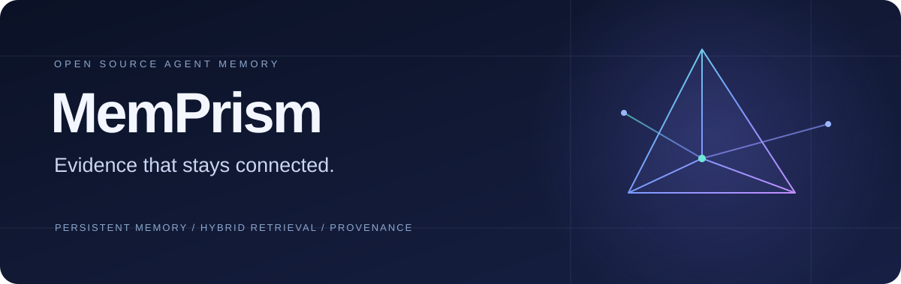
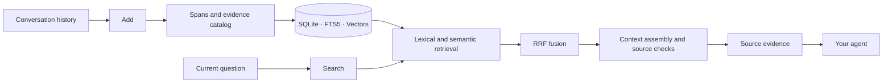

<div align="center">

**English** | [简体中文](README.zh-CN.md)



**Persistent, traceable memory for AI agents.**

Turn conversation history into usable evidence. Bring context to every interaction.

[](docs/REPRODUCING.md)
[](docs/ARCHITECTURE.md)
[](LICENSE)

[Quickstart](#quickstart) · [Architecture](docs/ARCHITECTURE.md) · [API](#api) · [Evaluation](docs/EVALUATION.md)

</div>

---

## Memory, with context.

MemPrism is an open-source long-term memory engine for AI assistants and agents. Two interfaces, **Add / Search**, turn incoming conversations into searchable history and return relevant evidence grounded in the original messages.

**Hybrid retrieval, context assembly, and consistency management in one memory pipeline.** Built on SQLite / WAL, MemPrism combines FTS5 lexical retrieval, exact vector search, and Reciprocal Rank Fusion (RRF) for applications that need self-hosting, inspectable data, and reproducible behavior.

## Why MemPrism

| Capability | What it enables |
| :--- | :--- |
| **Source provenance** | Memories stay linked to stored messages, span offsets, and source hashes, so retrieved evidence can be traced back. |
| **Lexical × semantic retrieval** | Find exact keywords and relevant paraphrases, then combine candidates from both retrieval paths. |
| **Context preservation** | Group rules, references, table headers, and rows by dependency to retain the context surrounding individual matches. |
| **Continuous updates** | Coordinate streaming writes and historical retrieval through transactional publication, idempotent receipts, and read snapshots. |
| **Deterministic processing** | The current configuration builds spans and evidence catalogs with rules, without generative LLM extraction, summarization, or reranking. |
| **Self-hosted storage** | Keep memory in a single-node SQLite database, integrate over HTTP, and independently verify source and runtime identities. |

Semantic retrieval uses an external embedding provider. The current configuration uses DashScope `text-embedding-v4` at 1,024 dimensions; provider charges apply.

## From conversation to evidence



**Store.** Preserve original messages and build spans, vectors, and an evidence catalog. Return a success receipt after the required publication completes.

**Retrieve.** Fuse lexical and semantic candidates within the user's scope and a read snapshot, then assemble supporting evidence around time, state, and rules.

**Use.** Return original evidence within result and output budgets. Your agent handles the answer or the next action.

## Quickstart

Use **Python 3.12.11** and a fresh database path. The Bash example below initializes an empty database without evaluation data. Do not initialize a database that is already serving requests.

```bash
set -e
git clone https://github.com/azhimiao/memprism.git
cd memprism/our-system
python3.12 -m venv .venv
. .venv/bin/activate
python -m pip install --no-deps -r requirements-cycle2.txt

export TIKTOKEN_CACHE_DIR="$PWD/.token-cache"
python -c "import tiktoken; tiktoken.get_encoding('o200k_base')"

set -a
. deploy/server/env.evaluated.example
set +a
export AML_DB_PATH="$PWD/data/aml.sqlite"
export AML_HOST=127.0.0.1 AML_PORT=8787
export AML_SERVICE_API_KEY='<choose-a-service-key>'
export DASHSCOPE_API_KEY='<your-DashScope-key>'

python -m deploy.runtime --configuration
python -c "from deploy.runtime import build_app; build_app()"
python -m deploy.start
```

The tokenizer downloads public encoding assets on first setup. Empty-database initialization does not request embeddings; actual Add/Search dense retrieval requires valid provider credentials. The runtime checks Python, dependencies, encoding assets, and database identity. See the [reproduction guide](docs/REPRODUCING.md) for complete instructions and existing-database handling.

## API

Once the service is running and its service key is configured, store and retrieve memory over HTTP. This synthetic example makes actual embedding requests.

```python
import os
import httpx

with httpx.Client(
    base_url="http://127.0.0.1:8787",
    headers={"Authorization": f"Bearer {os.environ['AML_SERVICE_API_KEY']}"},
    timeout=120,
) as client:
    # Save a conversation; reuse request_id when replaying this request.
    added = client.post("/add", json={
        "request_id": "demo-001",
        "user_id": "alice",
        "session_id": "planning",
        "messages": [{"role": "user", "content": "I prefer quiet cafes and usually visit on Friday afternoons."}],
    })
    added.raise_for_status()

    # Retrieve source evidence for your agent.
    found = client.post("/search", json={
        "user_id": "alice",
        "query": "When do I usually visit cafes, and what are my preferences?",
        "top_k": 5,
    })
    found.raise_for_status()
    for memory in found.json()["data"]:
        print(memory["content"])
```

| Endpoint | Purpose |
| :--- | :--- |
| `POST /add` | Store conversations and publish indexes, with idempotent replay of identical requests. |
| `POST /search` | Return source evidence as `{"data": [...]}` within the specified user's scope. |
| `GET /health` | Check control readiness and configuration identity. |

Add/Search use Bearer Token authentication. See the [protocol models](our-system/app/models.py) for field definitions. Manage service, embedding, and evaluation credentials separately. Deployments must also authorize callers' access to user scopes.

## Use cases

- **Personal AI assistants:** Retrieve preferences, plans, and background across conversations.
- **Workflow agents:** Find historical rules, procedures, and supporting materials.
- **Long-running conversations:** Keep adding interactions while preserving inspectable historical evidence.
- **Memory research:** Study retrieval and consistency using fixed source identities and synthetic tests.

## Open verification

This repository publishes the runtime source snapshot used at completion of the Agent Memory Leaderboard Cycle 2 textual Full evaluation: **9,602 / 9,602 items completed**, across the Textual and Streaming branches. See the [evaluation record](docs/EVALUATION.md) for score reporting, version history, and official result status.

Public-release engineering validation recorded **1,322 application tests passed and 24 gateway tests passed**, with 35 existing tests skipped. All 50 runtime files were checked byte for byte against the frozen evaluation-completion snapshot. [Verification record](releases/verification.json)

## Documentation

The detailed guides below are currently in Simplified Chinese; this page provides the English overview and setup examples.

| Guide | Contents |
| :--- | :--- |
| [Architecture](docs/ARCHITECTURE.md) | Data flow, retrieval, evidence assembly, consistency, and implementation limits. |
| [Deployment and reproduction](docs/REPRODUCING.md) | Environment, configuration, initialization, startup, and verification. |
| [Evaluation](docs/EVALUATION.md) | Full completion, score reporting, and runtime versions. |
| [Runtime manifest](releases/runtime-103.json) | SHA256 identities of the published runtime files. |
| [Research references](docs/REFERENCES.md) | Related work and underlying technical attribution. |

The implementation uses exact vector scanning, so retrieval cost grows with each user's history. Single-node write coordination and external embedding latency also affect throughput. Consult the [architecture guide](docs/ARCHITECTURE.md) when planning deployment and scale.

## License

[GNU Affero General Public License v3.0](LICENSE).
