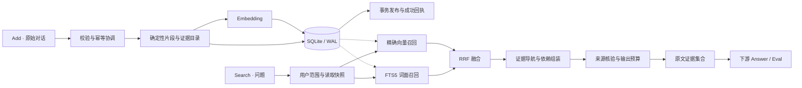

<div align="center">

# MemPrism

### 让长期记忆成为可追溯、可检索、可持续更新的证据。

**Hybrid retrieval · Source provenance · Deterministic evidence assembly**

[技术架构](docs/ARCHITECTURE.md) · [复现指南](docs/REPRODUCING.md) · [评测记录](docs/EVALUATION.md) · [来源与贡献](#来源与贡献)

</div>

MemPrism 是面向 Agent 长期记忆的 Add/Search 服务。它将原始对话保存为事实来源，以 **SQLite FTS5、精确向量检索和 RRF 融合**召回候选，再按时间、状态、规则和上下文依赖组织证据，供下游模型回答。

这次评测配置采用确定性的记忆写入与证据组装，**不调用生成式 LLM 做抽取、摘要、回答或重排序**。语义检索使用 DashScope `text-embedding-v4`；Embedding 是外部模型调用，会产生供应商费用。

## 评测状态

| 项目 | 当前记录 |
|---|---|
| 赛事 | Agent Memory Leaderboard · Cycle 2 |
| 赛道与组别 | 文本记忆 · 学术／开源方法榜 |
| 系统／参评版本 | `Memprism` / `memprism-hybrid-037` |
| Full 状态 | **已成功完成：9,602 / 9,602** |
| 分支完成数 | Textual 5,609；Streaming 3,993 |
| 本次报告成绩 | **48 分**，由参赛方报告；当前记录未提供精确小数 |
| 公榜状态 | 等待主办方复核与正式榜单，不据此声明获奖或排名 |
| 本次发布 | 完成评测时的 `local-103` 引擎；50 份运行文件逐文件核对 |

上述完成状态来自 2026-11-05 保存的平台状态。完整历史评测包含多次中断恢复与工程修复，本次发布是**完成评测时的运行源码快照**，不将它描述为从首个请求起完全未变的版本。48 分不与早期 Smoke 或本地代理评分混作同一结果。详情见[评测记录](docs/EVALUATION.md)。

## 设计重点

**记忆具有原文依据。** 原始消息、片段偏移、来源哈希与派生索引分开保存；检索结果在返回前重新检查来源和可见性，使证据可以回到实际保存的对话。

**检索覆盖词面与语义。** FTS5 负责名称、关键词和明确条件，精确 Dense 检索补充不同表述的相关证据，RRF 统一排序，避免直接混加尺度不同的检索分数。

**证据组织保留上下文依赖。** 确定性证据目录支持跨历史导航，并将规则与引用、表头与数据行等相关片段成组选择，减少单条命中被截离上下文的问题。

**写入与读取有明确边界。** 幂等回执、任务租约、事务发布和读取快照共同约束 Add/Search。健康探测只核服务控制信息，实际业务路径仍执行所需的数据、来源和发布状态校验。

## 技术路径



| 层次 | 实际实现 | 作用 |
|---|---|---|
| 原始记忆 | 用户隔离的消息、来源偏移与哈希 | 保留事实来源与归因 |
| 派生索引 | FTS5、片段向量、确定性证据目录 | 支持多条召回路径 |
| 查询与排序 | 有界长问题处理、精确 Dense、RRF | 融合词面与语义候选 |
| 证据组织 | 历史导航、依赖分组、显式状态及披露标记 | 保留回答所需的相关上下文 |
| 一致性 | 幂等回执、租约 fencing、事务与快照 | 约束重放、发布与并发可见性 |
| 服务效率 | 版本感知的核验复用、有界连接池 | 减少重复扫描及连接建立 |

评测策略为 `evidence_architecture_v1`：候选上限 200，返回条数上限 100，RRF `k=60`，Embedding 维度 1024。配置身份和源码身份分别记录；相同配置哈希不代表相同源码。精确 Dense 扫描的成本会随用户历史向量数量增长，当前没有使用近似向量索引来声明次线性检索。

## 快速复现

使用 **Python 3.12.11**，在新的数据库路径上运行。以下 Bash 示例初始化空库，不包含正式评测数据；不要对正在服务的评测库执行初始化。

```bash
set -e
git clone https://github.com/azhimiao/memprism.git
cd memprism/our-system
python3.12 -m venv .venv
. .venv/bin/activate
python -m pip install --no-deps -r requirements-cycle2.txt

export TIKTOKEN_CACHE_DIR="$PWD/.token-cache"
python -c "import tiktoken; tiktoken.get_encoding('o200k_base')"

set -a
. deploy/server/env.evaluated.example
set +a
export AML_DB_PATH="$PWD/data/aml.sqlite"
export AML_HOST=127.0.0.1 AML_PORT=8787
export AML_SERVICE_API_KEY='<choose-a-service-key>'
export DASHSCOPE_API_KEY='<your-DashScope-key>'

python -m deploy.runtime --configuration
python -c "from deploy.runtime import build_app; build_app()"
python -m deploy.start
```

Tokenizer 首次准备会下载公开编码资产；初始化空库不需要请求 Embedding，实际 Add/Search 的 Dense 路径需要有效供应商密钥。运行时会核对 Python、依赖、编码资产和数据库身份。完整步骤与现有库的使用边界见[复现指南](docs/REPRODUCING.md)。

## API

| 接口 | 契约 |
|---|---|
| `POST /add` | 同步保存消息并完成要求的索引发布；相同请求重放返回已有结果，冲突重用请求 ID 返回 409 |
| `POST /search` | 在指定用户范围内返回 `{"data": [...]}`，按 `top_k` 和预算限制原文证据 |
| `GET /health` | 返回服务控制就绪状态与配置身份；不能单凭 200 推断全部历史已经审计 |

Add/Search 使用 `Authorization: Bearer <service-key>`。服务鉴权密钥、Embedding 密钥与平台评测密钥各有用途，均不写入仓库。请求字段以[官方 API Guide](https://agentmemories.ai/api-guide)和本仓库的[协议模型](our-system/app/models.py)为准。

## 验证与边界

公开测试使用合成输入与测试替身，不分发赛事原始对话、数据库、平台答案或私有运行日志。源码清单见 [`releases/runtime-103.json`](releases/runtime-103.json)，可独立核对本次发布对应的 50 份运行文件。

```bash
cd our-system
python -m pip install -r requirements-verification.txt
python -m pytest tests -q -p no:cacheprovider --basetemp="$(mktemp -d)/pytest"
```

工程验收、合成性能实验、正式评测成绩分别报告。现有实现仍受单机 SQLite 写入协调、精确向量扫描和外部 Embedding 延迟影响；显式状态和敏感标记规则也不等同于完整语义冲突消解或通用隐私识别能力。见[技术架构与限制](docs/ARCHITECTURE.md)。

## 来源与贡献

MemPrism 的实现贡献集中在**来源绑定的证据目录、依赖保持的证据组装、事务发布与快照核验，以及针对流式读写的工程实现**。FTS、Embedding、RRF 和既有记忆系统的基础思想均有明确来源；本仓库不声称发明这些通用方法，也不以本次结果声明优于所有参考系统。

| 参考工作 | 研究版本 | 借鉴方向与本项目的实现取舍 |
|---|---|---|
| [InvMem](https://github.com/wenxiaof345-ctrl/vanilla-rag-memory) | `31ab7bf9` | 用户内词面／语义融合；本项目加入来源核验及确定性证据组装 |
| [ActiveMemoryIndex](https://github.com/linxuhao/ActiveMemoryIndex) | `9bb0497c` | 原始输入与派生表示分离；本项目围绕同步发布和回执实现 |
| [Mem0](https://github.com/mem0ai/mem0) | `94c3fe9f` | 用户范围、更新与历史；当前配置采用确定性规则而非生成式抽取 |
| [MemMachine](https://github.com/MemMachine/MemMachine) | `d57f5cb3` | 区分检索表示与返回证据；返回内容绑定保存的来源 |
| [memfusion](https://github.com/huangpengtao00-dotcom/memfusion-memory) | `8578b646` | 分离融合排名和相关性含义 |
| [ChronoHybridMem](https://github.com/Tin11Mn/chrono-hybrid-mem) | `a8411527` | 查询计划、支持证据及时间来源 |
| [M-flow](https://github.com/FlowElement-xinliuyuansu/m_flow) | `0d585cda` | 过程性记忆组织；保留规则和引用的依赖关系 |
| [agent-memory-leaderboard-2026](https://github.com/cenjoy/agent-memory-leaderboard-2026) | `553f9c96` | 新旧状态共存／替换与披露边界 |

RRF 原始工作：G. V. Cormack, C. L. A. Clarke, S. Büttcher, *Reciprocal Rank Fusion outperforms Condorcet and individual Rank Learning Methods*, SIGIR 2009，[DOI](https://doi.org/10.1145/1571941.1572114)。运行依赖包括 [SQLite FTS5](https://sqlite.org/fts5.html)、DashScope `text-embedding-v4`、OpenAI `tiktoken`、FastAPI、HTTPX 等；精确版本见 [requirements-cycle2.txt](our-system/requirements-cycle2.txt)。

## 仓库导览

```text
our-system/app/       参评记忆引擎：写入、检索、证据与一致性
our-system/deploy/    冻结运行时检查与服务入口
our-system/tests/     合成契约、隔离、来源、并发与恢复测试
docs/                架构、复现、评测与部署说明
releases/            源码身份及经过筛选的公开评测记录
operations/          通道恢复的可复用参考组件
experiments/         测试依赖的历史代码与身份清单
```

## License

[GNU Affero General Public License v3.0](LICENSE)。
