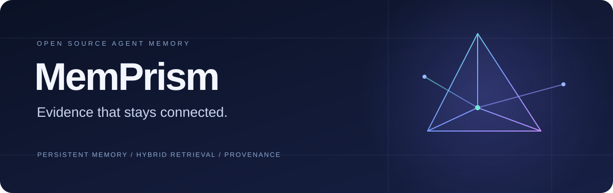
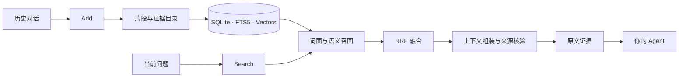

<div align="center">

[English](README.md) | **简体中文**



**为 AI Agent 提供持久、可追溯的长期记忆。**

从历史对话到可用证据，让每一次交互都有上下文。

[](docs/REPRODUCING.md)
[](docs/ARCHITECTURE.md)
[](LICENSE)

[快速开始](#快速开始) · [技术架构](docs/ARCHITECTURE.md) · [API 接入](#api-接入) · [评测记录](docs/EVALUATION.md)

</div>

---

## Memory, with context.

MemPrism 是面向 AI 助手与 Agent 的开源长期记忆引擎。通过 **Add / Search** 两个接口，将持续到来的对话组织成可检索的历史，在需要时返回与问题相关、带有原文依据的证据。

**混合检索、上下文组装与一致性管理，在同一条记忆链路中完成。** 底层采用 SQLite / WAL，结合 FTS5 词面检索、精确向量检索和 RRF 排名融合，适合需要自托管、检查数据与复现行为的应用。

## 为什么选择 MemPrism

| 能力 | 为应用带来的价值 |
| :--- | :--- |
| **原文可追溯** | 记忆绑定保存的消息、片段偏移与来源哈希，让返回的证据有据可查。 |
| **词面 × 语义** | 同时召回明确关键词与不同措辞的相关内容，统一融合多路候选。 |
| **上下文完整性** | 按依赖组织规则、引用、表头与数据行，保留单条命中之外的必要上下文。 |
| **持续更新** | 借助事务发布、幂等回执与读取快照，协调流式写入和历史检索。 |
| **确定性处理** | 当前配置以规则构建片段和证据目录，无需生成式 LLM 抽取、摘要或重排序。 |
| **可自托管** | 记忆存储使用单机 SQLite，HTTP 接口方便集成，源码与运行身份可独立核验。 |

语义检索使用外部 Embedding 服务，当前配置为 DashScope `text-embedding-v4`（1024 维），会产生供应商费用。

## 从对话到证据



**存下来。** 保留原始消息，建立片段、向量和证据目录；完成所需发布后返回成功回执。

**找得到。** 在用户范围与读取快照内，融合词面和语义候选，再组织时间、状态和规则相关的支持证据。

**用得上。** 按条数和预算返回原文证据，由你的 Agent 完成回答或后续任务。

## 快速开始


使用 **Python 3.12.11**，在新的数据库路径上运行。以下 Bash 示例初始化空库，不包含正式评测数据；不要对正在服务的评测库执行初始化。

```bash
set -e
git clone https://github.com/azhimiao/memprism.git
cd memprism/our-system
python3.12 -m venv .venv
. .venv/bin/activate
python -m pip install --no-deps -r requirements-cycle2.txt

export TIKTOKEN_CACHE_DIR="$PWD/.token-cache"
python -c "import tiktoken; tiktoken.get_encoding('o200k_base')"

set -a
. deploy/server/env.evaluated.example
set +a
export AML_DB_PATH="$PWD/data/aml.sqlite"
export AML_HOST=127.0.0.1 AML_PORT=8787
export AML_SERVICE_API_KEY='<choose-a-service-key>'
export DASHSCOPE_API_KEY='<your-DashScope-key>'

python -m deploy.runtime --configuration
python -c "from deploy.runtime import build_app; build_app()"
python -m deploy.start
```

Tokenizer 首次准备会下载公开编码资产；初始化空库不需要请求 Embedding，实际 Add/Search 的 Dense 路径需要有效供应商密钥。运行时会核对 Python、依赖、编码资产和数据库身份。完整步骤与现有库的使用边界见[复现指南](docs/REPRODUCING.md)。

## API 接入

启动服务并配置好服务密钥后，可通过 HTTP 写入与检索。以下为合成示例，实际请求会调用 Embedding 服务。

```python
import os
import httpx

with httpx.Client(
    base_url="http://127.0.0.1:8787",
    headers={"Authorization": f"Bearer {os.environ['AML_SERVICE_API_KEY']}"},
    timeout=120,
) as client:
    # 保存一段对话；重放同一请求时保留 request_id。
    added = client.post("/add", json={
        "request_id": "demo-001",
        "user_id": "alice",
        "session_id": "planning",
        "messages": [{"role": "user", "content": "我喜欢安静的咖啡馆，通常周五下午去。"}],
    })
    added.raise_for_status()

    # 为下游 Agent 获取相关原文证据。
    found = client.post("/search", json={
        "user_id": "alice",
        "query": "我通常什么时候去咖啡馆，有什么偏好？",
        "top_k": 5,
    })
    found.raise_for_status()
    for memory in found.json()["data"]:
        print(memory["content"])
```

| 接口 | 用途 |
| :--- | :--- |
| `POST /add` | 保存对话并完成索引发布，支持相同请求的幂等重放。 |
| `POST /search` | 在指定用户范围内返回 `{"data": [...]}` 形式的原文证据。 |
| `GET /health` | 检查控制就绪状态与配置身份。 |

Add/Search 使用 Bearer Token。字段定义见[协议模型](our-system/app/models.py)；服务密钥、Embedding 密钥与评测密钥分别管理。部署方还需负责调用方的用户访问授权。

## 适用场景

- **个人 AI 助手**：在跨会话交流中找回偏好、计划与背景信息。
- **工作流 Agent**：检索历史规则、操作过程及支撑材料。
- **长期对话应用**：持续写入新交互，同时保留可检查的历史依据。
- **记忆系统研究**：使用固定源码身份与合成测试分析检索和一致性行为。

## 开放验证

本仓库发布了完成 Agent Memory Leaderboard Cycle 2 文本 Full 评测时的运行源码快照：**9,602 / 9,602 项完成**，包括 Textual 与 Streaming 两个分支。成绩口径、版本沿革和正式结果状态见[评测记录](docs/EVALUATION.md)。

公开发行的工程验证包含 **1,322 项应用测试通过、24 项网关测试通过**；另有 35 项原有测试跳过。50 份运行文件与评测结束时的冻结副本逐文件核验一致。[查看验证记录](releases/verification.json)

## 文档

| 文档 | 内容 |
| :--- | :--- |
| [技术架构](docs/ARCHITECTURE.md) | 数据流、检索、证据组织、一致性与实现边界。 |
| [部署与复现](docs/REPRODUCING.md) | 环境、配置、初始化、启动与验证。 |
| [评测记录](docs/EVALUATION.md) | Full 完成情况、成绩口径与运行版本。 |
| [运行文件清单](releases/runtime-103.json) | 公开运行文件的 SHA256 身份。 |
| [研究参考](docs/REFERENCES.md) | 相关工作与基础技术归属。 |

当前实现采用精确向量扫描，检索成本随用户历史规模增长；单机写入协调和外部 Embedding 延迟也会影响吞吐。部署与规模规划请参阅[架构说明](docs/ARCHITECTURE.md)。

## License

[GNU Affero General Public License v3.0](LICENSE)。
